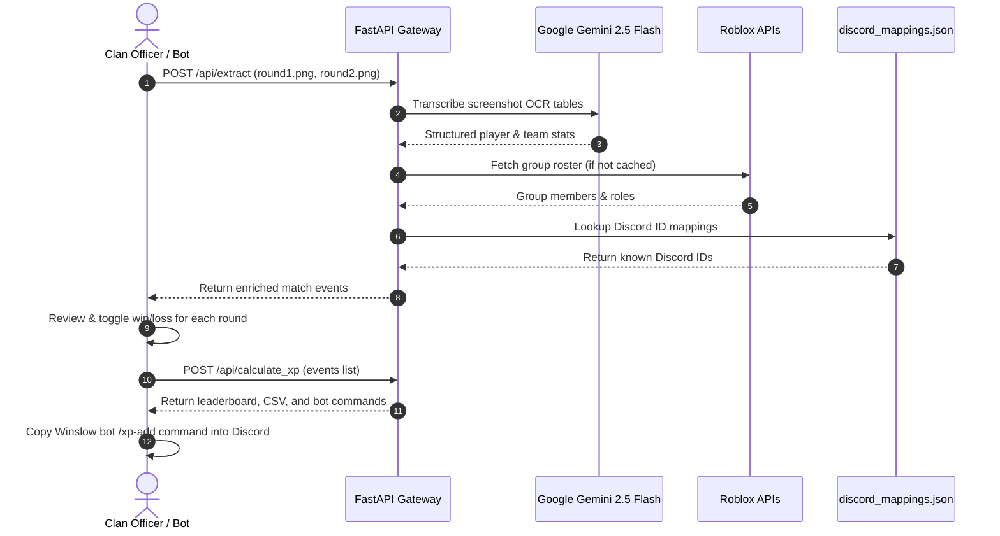

# REST API Specification & Reference Manual
## Roblox Event Extractor & XP Engine (Winslow Accord Ops)

---

## 1. Overview & Base URLs

The **Roblox Event Extractor & XP Engine** provides a high-performance REST API built on FastAPI. It powers multimodal OCR transcription of Roblox match screenshots, automated Roblox user and clan verification, multi-match attendance and XP calculations, and Discord-to-Roblox identity mapping.

### Base URLs

| Environment | Base URL | Description |
| :--- | :--- | :--- |
| **Production (Render)** | `https://roblox-event-extractor.onrender.com` | Hosted cloud production deployment |
| **Local Development** | `http://127.0.0.1:8000` | Local development server (`uvicorn app:app`) |

### Cross-Origin Resource Sharing (CORS)
The API enables CORS for all origins (`*`) by default, allowing web applications, command-line utilities, or Discord bots to interact with endpoints without cross-origin restrictions.

### Content Types
- **Standard Requests**: `application/json`
- **File Ingestion**: `multipart/form-data`
- **Responses**: `application/json; charset=utf-8`

---

## 2. API Endpoints Quick Reference

| Method | Endpoint | Description | Request Type | Auth |
| :--- | :--- | :--- | :--- | :--- |
| `GET` | [`/api/health`](#get-apihealth) | Service liveness and health probe | None | Public |
| `GET` | [`/api/config`](#get-apiconfig) | Retrieve runtime clan and XP configuration | None | Public |
| `POST` | [`/api/extract`](#post-apiextract) | Upload and transcribe screenshot images via Gemini Vision | `multipart/form-data` | Public |
| `POST` | [`/api/verify_user`](#post-apiverify_user) | Verify a Roblox user and clan membership | `application/json` | Public |
| `POST` | [`/api/calculate_xp`](#post-apicalculate_xp) | Compute XP, leaderboard, and Winslow Accord bot slash commands | `application/json` | Public |
| `GET` | [`/api/discord_ids`](#get-apidiscord_ids) | Retrieve all persistent Roblox-to-Discord mappings | None | Public |
| `POST` | [`/api/discord_ids`](#post-apidiscord_ids) | Create, update, or remove Roblox-to-Discord mappings | `application/json` | Public |

---

## 3. Exhaustive Endpoint Documentation

### `GET /api/health`

#### Description
Performs a lightweight liveness check to confirm backend process availability. Used by load balancers, container runners (e.g., Render, Docker), and uptime monitors.

#### Request
- **Headers**: `Accept: application/json`
- **Body**: None

#### Responses
- **`200 OK`**: Service is healthy and responsive.
  ```json
  {
    "status": "ok"
  }
  ```

#### Example cURL
```bash
curl -X GET "https://roblox-event-extractor.onrender.com/api/health" \
     -H "Accept: application/json"
```

---

### `GET /api/config`

#### Description
Returns the active server-side configuration, including default clan group identity and default XP award values for wins and losses.

#### Request
- **Headers**: `Accept: application/json`
- **Body**: None

#### Responses
- **`200 OK`**: Configuration parameters successfully loaded.
  ```json
  {
    "default_clan_name": "Winslow Accord",
    "default_clan_group_id": 825966682,
    "win_xp": 10,
    "loss_xp": 5
  }
  ```

#### Response Field Reference
| Field | Type | Description |
| :--- | :--- | :--- |
| `default_clan_name` | `string` | Display name of the primary clan (e.g. `"Winslow Accord"`). |
| `default_clan_group_id` | `integer` | Official Roblox group ID for roster validation (`825966682`). |
| `win_xp` | `integer` | Default XP awarded per player for a winning match (`10`). |
| `loss_xp` | `integer` | Default XP awarded per player for a match loss or attendance (`5`). |

#### Example cURL
```bash
curl -X GET "https://roblox-event-extractor.onrender.com/api/config" \
     -H "Accept: application/json"
```

---

### `POST /api/extract`

#### Description
Ingests one or more Roblox leaderboard / match scoreboard screenshots. For each image, the endpoint:
1. Performs multimodal vision OCR transcription via Google Gemini 2.5 Flash using structured JSON schemas.
2. Extracts match title, teams, player statistics (kills, damage, heals, caps, score).
3. Pre-fetches clan group rosters and runs OCR disambiguation (resolving `I` vs `l`, `0` vs `O`, `cl` vs `d`).
4. Enriches every identified player record with Roblox user ID, verification state, clan role, and known Discord snowflake ID.

#### Request
- **Content-Type**: `multipart/form-data`
- **Form Parameters**:
  - `files`: One or more image binary uploads (`image/png`, `image/jpeg`, `image/webp`). Required.
  - `clan_group_id`: Roblox group ID override. Optional (defaults to `DEFAULT_CLAN_GROUP_ID`).

#### Responses
- **`200 OK`**: Extraction and enrichment succeeded.
  ```json
  [
    {
      "filename": "scrim_round_1.png",
      "match_title": "Snow Core vs Winslow Accord",
      "teams": [
        {
          "team_name": "Winslow Accord",
          "score": "150",
          "players": [
            {
              "username": "Chaotlc",
              "kills": 18,
              "damage": 2450,
              "heals": 120,
              "caps": 2,
              "score": 380,
              "verified_name": "Chaotlc",
              "user_id": 12345678,
              "in_clan": true,
              "clan_role": "Officer",
              "is_verified": true,
              "discord_id": "249827498172938240"
            },
            {
              "username": "Valkyrie",
              "kills": 12,
              "damage": 1900,
              "heals": 450,
              "caps": 1,
              "score": 290,
              "verified_name": "Valkyrie",
              "user_id": 87654321,
              "in_clan": true,
              "clan_role": "Vanguard",
              "is_verified": true,
              "discord_id": "391829381928374619"
            }
          ]
        },
        {
          "team_name": "Snow Core",
          "score": "95",
          "players": [
            {
              "username": "OpponentAce",
              "kills": 14,
              "damage": 2100,
              "heals": 0,
              "caps": 0,
              "score": 210,
              "verified_name": "OpponentAce",
              "user_id": 99887766,
              "in_clan": false,
              "clan_role": null,
              "is_verified": true,
              "discord_id": null
            }
          ]
        }
      ]
    }
  ]
  ```
- **`422 Unprocessable Entity`**: Missing `files` form field or invalid file format.
- **`500 Internal Server Error`**: Gemini API failure, network timeout, or unparseable image.
  ```json
  {
    "detail": "Failed to process 'scrim_round_1.png': Gemini API rate limit exceeded."
  }
  ```

#### Example cURL
```bash
curl -X POST "https://roblox-event-extractor.onrender.com/api/extract" \
     -F "files=@round1.png" \
     -F "files=@round2.png" \
     -F "clan_group_id=825966682"
```

---

### `POST /api/verify_user`

#### Description
Verifies a single Roblox username against Roblox Public APIs and clan membership. Resolves visual OCR ambiguities (e.g., lowercase `l` vs uppercase `I`, digit `0` vs `O`, `cl` vs `d`).

#### Request
- **Content-Type**: `application/json`
- **Body Schema (`VerifyUserRequest`)**:
  ```json
  {
    "username": "Chaotic",
    "clan_group_id": 825966682
  }
  ```

| Field | Type | Required | Description |
| :--- | :--- | :--- | :--- |
| `username` | `string` | **Yes** | Raw username captured from screenshot or manual input. |
| `clan_group_id` | `integer` | No | Roblox clan group ID to verify membership against. Defaults to configured clan ID. |

#### Responses
- **`200 OK`**: Verification lookup completed.
  *Example (Verified Clan Member with OCR correction):*
  ```json
  {
    "raw": "Chaotic",
    "verified_name": "Chaotlc",
    "user_id": 12345678,
    "in_clan": true,
    "clan_role": "Officer",
    "is_verified": true
  }
  ```
  *Example (Unverified / Nonexistent User):*
  ```json
  {
    "raw": "GhostOperator9999",
    "verified_name": null,
    "user_id": null,
    "in_clan": false,
    "clan_role": null,
    "is_verified": false
  }
  ```
- **`422 Unprocessable Entity`**: Malformed payload (e.g., missing `username`).

#### Example cURL
```bash
curl -X POST "https://roblox-event-extractor.onrender.com/api/verify_user" \
     -H "Content-Type: application/json" \
     -d '{
       "username": "Chaotic",
       "clan_group_id": 825966682
     }'
```

---

### `POST /api/calculate_xp`

#### Description
Computes aggregated match statistics, attendance records, and total XP across multiple matches or rounds. Generates ready-to-use exports:
1. An ordered **leaderboard** (sorted by total XP descending, then alphabetically).
2. Clean **Discord-formatted summary text**.
3. A standardized **CSV export** of all player metrics.
4. Batch-optimized **Winslow Accord custom bot slash commands** (`/xp-add target:<targets> amount:<amount>`) grouped by XP tier (returned via `bot_commands` and legacy alias `clan_labs_commands`).

#### Request
- **Content-Type**: `application/json`
- **Body Schema (`CalculateXPRequest`)**:
  ```json
  {
    "events": [
      {
        "event_id": "event_01",
        "event_name": "Round 1 - Outpost Zeta",
        "is_win": true,
        "players": [
          {
            "username": "Chaotlc",
            "verified_name": "Chaotlc",
            "discord_id": "249827498172938240",
            "clan_role": "Officer",
            "kills": 18,
            "damage": 2450,
            "heals": 120,
            "caps": 2
          },
          {
            "username": "Valkyrie",
            "verified_name": "Valkyrie",
            "discord_id": "391829381928374619",
            "clan_role": "Vanguard",
            "kills": 12,
            "damage": 1900,
            "heals": 450,
            "caps": 1
          }
        ]
      },
      {
        "event_id": "event_02",
        "event_name": "Round 2 - Outpost Zeta",
        "is_win": false,
        "players": [
          {
            "username": "Chaotlc",
            "verified_name": "Chaotlc",
            "discord_id": "249827498172938240",
            "clan_role": "Officer",
            "kills": 14,
            "damage": 1800,
            "heals": 80,
            "caps": 0
          }
        ]
      }
    ],
    "win_xp": 10,
    "loss_xp": 5
  }
  ```

| Field | Type | Required | Description |
| :--- | :--- | :--- | :--- |
| `events` | `array[Event]` | **Yes** | List of event objects containing outcome flag and player rosters. |
| `win_xp` | `integer` | No | XP awarded per player for an event marked `is_win: true` (default: 10). |
| `loss_xp` | `integer` | No | XP awarded per player for an event marked `is_win: false` (default: 5). |

#### Responses
- **`200 OK`**: Calculation completed successfully.
  ```json
  {
    "leaderboard": [
      {
        "username": "Chaotlc",
        "discord_id": "249827498172938240",
        "clan_role": "Officer",
        "total_xp": 15,
        "events_attended": [
          "Round 1 - Outpost Zeta",
          "Round 2 - Outpost Zeta"
        ],
        "wins": 1,
        "losses": 1,
        "total_kills": 32,
        "total_damage": 4250,
        "total_heals": 200,
        "total_caps": 2
      },
      {
        "username": "Valkyrie",
        "discord_id": "391829381928374619",
        "clan_role": "Vanguard",
        "total_xp": 10,
        "events_attended": [
          "Round 1 - Outpost Zeta"
        ],
        "wins": 1,
        "losses": 0,
        "total_kills": 12,
        "total_damage": 1900,
        "total_heals": 450,
        "total_caps": 1
      }
    ],
    "discord_text": "Chaotlc: 15 XP\nValkyrie: 10 XP",
    "csv_text": "Username,Total_XP,Events_Attended,Wins,Losses,Total_Kills,Total_Damage,Total_Heals,Total_Caps\nChaotlc,15,2,1,1,32,4250,200,2\nValkyrie,10,1,1,0,12,1900,450,1",
    "bot_commands": "/xp-add target:<@249827498172938240> amount:15\n/xp-add target:<@391829381928374619> amount:10",
    "clan_labs_commands": "/xp-add target:<@249827498172938240> amount:15\n/xp-add target:<@391829381928374619> amount:10",
    "summary": {
      "total_events": 2,
      "unique_players": 2,
      "total_xp_awarded": 25
    }
  }
  ```
- **`422 Unprocessable Entity`**: Invalid event structure or data types.
- **`500 Internal Server Error`**: Unexpected calculation error.

#### Example cURL
```bash
curl -X POST "https://roblox-event-extractor.onrender.com/api/calculate_xp" \
     -H "Content-Type: application/json" \
     -d '{
       "events": [
         {
           "event_name": "Raid Zeta",
           "is_win": true,
           "players": [
             {"username": "Chaotlc", "discord_id": "249827498172938240", "kills": 10}
           ]
         }
       ],
       "win_xp": 10,
       "loss_xp": 5
     }'
```

---

### `GET /api/discord_ids`

#### Description
Returns the entire persistent dictionary of lowercased Roblox usernames mapped to their corresponding Discord user snowflake IDs (`discord_mappings.json`).

#### Request
- **Headers**: `Accept: application/json`
- **Body**: None

#### Responses
- **`200 OK`**: Mapping table retrieved.
  ```json
  {
    "mappings": {
      "chaotlc": "249827498172938240",
      "valkyrie": "391829381928374619",
      "reaper99": "847291820491827364"
    }
  }
  ```

#### Example cURL
```bash
curl -X GET "https://roblox-event-extractor.onrender.com/api/discord_ids" \
     -H "Accept: application/json"
```

---

### `POST /api/discord_ids`

#### Description
Creates, updates, or deletes Roblox-to-Discord ID mappings. Supports both single-entry updates and bulk batch updates. All writes are persisted to disk atomically under a thread lock.

#### Request
- **Content-Type**: `application/json`
- **Body Schema (`DiscordMappingPayload`)**:
  
  **Mode A: Single User Update**
  ```json
  {
    "username": "chaotlc",
    "discord_id": "249827498172938240"
  }
  ```
  *(To remove a mapping, set `discord_id` to `""` or `null`).*

  **Mode B: Bulk User Update**
  ```json
  {
    "mappings": {
      "chaotlc": "249827498172938240",
      "valkyrie": "391829381928374619",
      "reaper99": ""
    }
  }
  ```

#### Responses
- **`200 OK`**: Update applied successfully; returns full updated mapping dictionary.
  ```json
  {
    "status": "ok",
    "mappings": {
      "chaotlc": "249827498172938240",
      "valkyrie": "391829381928374619"
    }
  }
  ```
- **`422 Unprocessable Entity`**: Invalid JSON body structure.

#### Example cURL
```bash
# Single update
curl -X POST "https://roblox-event-extractor.onrender.com/api/discord_ids" \
     -H "Content-Type: application/json" \
     -d '{
       "username": "Chaotlc",
       "discord_id": "249827498172938240"
     }'

# Bulk update
curl -X POST "https://roblox-event-extractor.onrender.com/api/discord_ids" \
     -H "Content-Type: application/json" \
     -d '{
       "mappings": {
         "chaotlc": "249827498172938240",
         "shadow_recon": "581928301928472910"
       }
     }'
```

---

## 4. Data Models & Schemas

The following schemas define the request and response structures utilized across the REST API.

### `ConfigResponse`
```typescript
interface ConfigResponse {
  default_clan_name: string;      // e.g. "Winslow Accord"
  default_clan_group_id: number;  // e.g. 825966682
  win_xp: number;                 // e.g. 10
  loss_xp: number;                // e.g. 5
}
```

### `ExtractedPlayer`
```typescript
interface ExtractedPlayer {
  username: string;               // Raw username transcribed from image
  kills?: number;                 // Kill count
  damage?: number;                // Total damage dealt
  heals?: number;                 // Total healing performed
  caps?: number;                  // Objective captures / flags
  score?: number;                 // Total scoreboard points
  verified_name?: string | null;  // Canonical Roblox username after OCR disambiguation
  user_id?: number | null;        // Numeric Roblox user ID
  in_clan: boolean;               // Clan membership status
  clan_role?: string | null;      // Clan hierarchy role (e.g. "Officer")
  is_verified: boolean;           // Whether the username resolves on Roblox
  discord_id?: string | null;     // Mapped Discord snowflake ID
}
```

### `ExtractedTeam`
```typescript
interface ExtractedTeam {
  team_name: string;              // e.g. "Winslow Accord", "Raiders"
  score?: string;                 // Team score / round points
  players: ExtractedPlayer[];     // Roster of players belonging to team
}
```

### `LeaderboardEvent`
```typescript
interface LeaderboardEvent {
  filename: string;               // Name of uploaded screenshot file
  match_title?: string;           // Match header or scoreboard title
  teams: ExtractedTeam[];         // Extracted team rosters
}
```

### `VerifyUserRequest`
```typescript
interface VerifyUserRequest {
  username: string;               // Username to look up
  clan_group_id?: number | null;  // Target Roblox group ID (optional)
}
```

### `VerifyUserResponse`
```typescript
interface VerifyUserResponse {
  raw: string;                    // Input query string
  verified_name: string | null;   // Canonical Roblox username (or null)
  user_id: number | null;         // Roblox user ID (or null)
  in_clan: boolean;               // Clan membership flag
  clan_role: string | null;       // Clan role name (or null)
  is_verified: boolean;           // User existence on Roblox
}
```

### `CalculateXPRequest`
```typescript
interface CalculateXPRequest {
  events: {
    event_id?: string;            // Unique match or round identifier
    event_name?: string;          // Human-readable title
    is_win: boolean;              // True for win, False for loss
    players: {
      username: string;           // Raw or input username
      verified_name?: string;     // Canonical Roblox username (preferred)
      discord_id?: string;        // Discord snowflake ID
      clan_role?: string;         // Clan role
      kills?: number;
      damage?: number;
      heals?: number;
      caps?: number;
    }[];
  }[];
  win_xp?: number;                // XP awarded for winning event (optional)
  loss_xp?: number;               // XP awarded for losing event (optional)
}
```

### `LeaderboardEntry`
```typescript
interface LeaderboardEntry {
  username: string;               // Canonical player username
  discord_id: string | null;      // Discord snowflake ID
  clan_role: string | null;       // Clan hierarchy rank
  total_xp: number;               // Aggregated XP across events
  events_attended: string[];      // Names of attended matches/rounds
  wins: number;                   // Number of won matches
  losses: number;                 // Number of lost matches
  total_kills: number;            // Cumulative kills
  total_damage: number;           // Cumulative damage
  total_heals: number;            // Cumulative healing
  total_caps: number;             // Cumulative captures
}
```

### `CalculateXPResponse`
```typescript
interface CalculateXPResponse {
  leaderboard: LeaderboardEntry[];
  discord_text: string;           // Formatted "Username: <XP> XP" plain text
  csv_text: string;               // Full CSV string formatted for spreadsheet import
  bot_commands: string;           // Winslow Accord custom bot slash commands (/xp-add target:<targets> amount:<amount>)
  clan_labs_commands: string;     // Legacy alias for bot_commands (/xp-add target:<targets> amount:<amount>)
  summary: {
    total_events: number;         // Count of events processed
    unique_players: number;       // Count of distinct participants
    total_xp_awarded: number;     // Grand total XP awarded across all participants
  };
}
```

### Winslow Accord Bot Command Format (`/xp-add`)
The Winslow Accord custom bot uses slash commands to assign clan XP using the `/xp-add target:<targets> amount:<amount>` syntax. Commands are consolidated and grouped by XP value descending:

```text
/xp-add target:<@249827498172938240> player2 amount:15
```

- **Target Resolution Rule**: For each player, the engine uses their Discord snowflake mention (`<@ID>`) if mapped, or seamlessly falls back to their Roblox username if unmapped (e.g. `player2`). No manual placeholders (such as `[MISSING_ID:...]`) are used.
- **Command Batching & Grouping**: All players awarded an identical XP total are merged into a single command with space-separated targets in the `target:` argument.
- **Backwards Compatibility**: The response payload includes both `bot_commands` and `clan_labs_commands` (legacy key containing the identical string) to guarantee backwards compatibility with existing clients.

---

## 5. Error Handling & HTTP Status Codes

The API follows standard REST HTTP status code conventions. All error responses include descriptive error messages in JSON format.

### Status Code Directory

| HTTP Status | Name | Cause | Example Scenario |
| :--- | :--- | :--- | :--- |
| **`200`** | `OK` | Request succeeded | Successful data retrieval, transcription, or update |
| **`400`** | `Bad Request` | Malformed input | Empty batch submission or unreadable request payload |
| **`422`** | `Unprocessable Entity` | Validation error | Missing required field `username` or invalid data type |
| **`429`** | `Too Many Requests` | Rate limit hit | Upstream Gemini API or Roblox API quota exhausted |
| **`500`** | `Internal Server Error`| Server failure | OCR parsing exception or unhandled backend crash |

### Standard Validation Error Response (`422`)
Produced automatically by FastAPI / Pydantic when fields are missing or typed incorrectly:

```json
{
  "detail": [
    {
      "loc": ["body", "username"],
      "msg": "field required",
      "type": "value_error.missing"
    }
  ]
}
```

### Standard Internal Error Response (`500`)
```json
{
  "detail": "Failed to process 'round1.png': Gemini API key quota exhausted. Please retry or rotate keys."
}
```

### Rate Limiting & Resilience Architecture
1. **Gemini Vision Failover**: The backend maintains multiple Gemini API keys (`GEMINI_API_KEYS`). If an API call encounters HTTP 429 (quota exhausted) or 503 (service unavailable), the engine automatically rotates to the next available API key and retries.
2. **Roblox Roster Caching**: Roblox group members are fetched with cursor pagination and cached in memory. Subsequent match transcriptions query the in-memory cache directly ($O(1)$ lookup), avoiding Roblox API rate limit exhaustion (`HTTP 429 Too Many Requests`).
3. **Atomic File Locking**: Writes to `discord_mappings.json` are gated by a threading lock (`threading.Lock()`), ensuring that concurrent requests cannot corrupt identity state.

---

## 6. End-to-End Workflow Integration Example

The following sequence illustrates how an external script or Discord bot processes an operation with 2 screenshot rounds:



---

## 7. Local Development & Testing Instructions

### Running Local Uvicorn Instance
```powershell
# Navigate to project directory
cd path/to/roblox-event-extractor

# Activate virtual environment (if applicable)
# .\venv\Scripts\Activate.ps1

# Start FastAPI server
uvicorn app:app --host 127.0.0.1 --port 8000 --reload
```

### Interactive API Documentation (Swagger / OpenAPI)
When running locally or on Render, FastAPI automatically hosts interactive API documentation:
- **Swagger UI**: [`http://127.0.0.1:8000/docs`](http://127.0.0.1:8000/docs)
- **ReDoc**: [`http://127.0.0.1:8000/redoc`](http://127.0.0.1:8000/redoc)
- **OpenAPI JSON**: [`http://127.0.0.1:8000/openapi.json`](http://127.0.0.1:8000/openapi.json)
