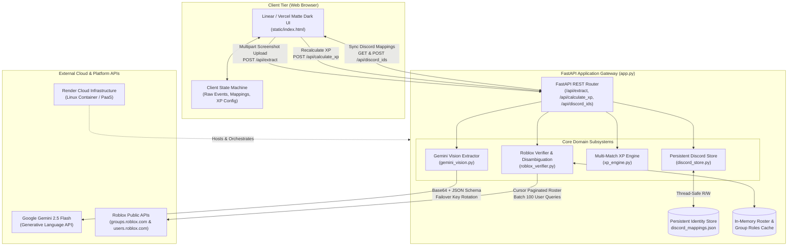
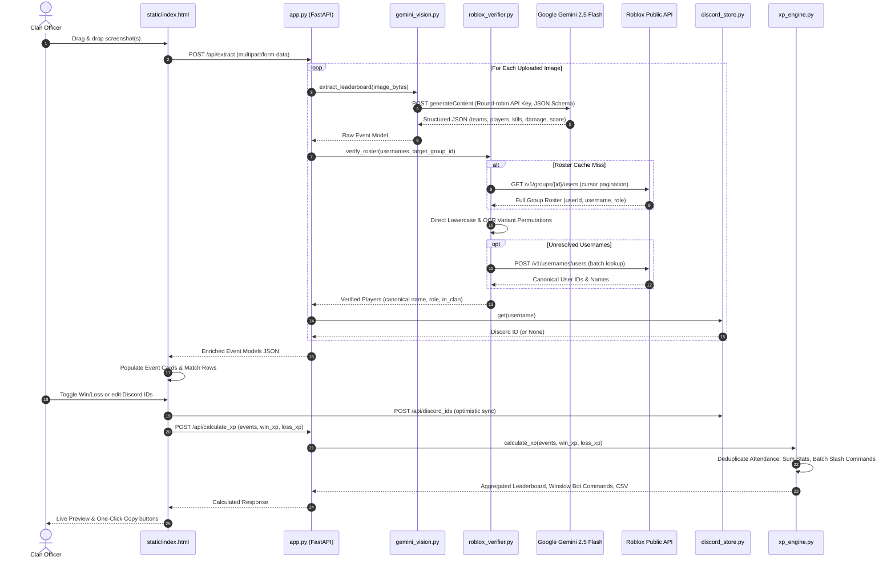

# System Architecture & Technical Specifications
## Roblox Event Extractor & Attendance Engine (Winslow Accord Ops)

---

## 1. Executive Summary & Design Principles

The **Roblox Event Extractor & Attendance Engine** is a specialized, production-ready attendance processing, OCR transcription, and XP calculation pipeline engineered for competitive Roblox clan operations (Winslow Accord, Group ID: `825966682`).

### Core Problem Space
1. **Severe OCR Degradation**: Leaderboard screenshots captured in the heat of battle suffer from low contrast, non-standard typography, low resolution, motion blur, and opaque/translucent overlay banners (such as the red **"YOU DIED"** respawn screen).
2. **Sans-Serif Visual Ambiguities**: Modern typography creates indistinguishable letterforms (e.g., uppercase `I` vs. lowercase `l`, `0` vs. `O`, `cl` vs. `d`, `rn` vs. `m`), leading naive OCR tools to fail username identification against Roblox databases.
3. **Multi-Match Operational Overhead**: Officers managing multi-round scrims or operations manually transcribe scores, cross-check rosters, calculate attendance XP, and generate Discord bot commands—a process prone to human error and bot rate-limit exhaustion.
4. **Discord Identity Disconnect**: Roblox usernames rarely match Discord handles; Winslow Accord's custom bot slash commands (`/xp-add target:... amount:...`) accept Discord user snowflakes (`<@ID>`) or Roblox usernames. Persisting mappings ensures members receive Discord notifications and credits while seamlessly falling back to Roblox usernames for unmapped players.

### Architectural Tenets
- **Deterministic Schema Enforcement**: Multimodal vision requests to Google Gemini 2.5 Flash strictly enforce typed JSON schemas, eliminating hallucinated output or formatting mismatches.
- **Clan-First Roster Disambiguation**: By pre-fetching and caching canonical Roblox group rosters, the verification layer transforms an $O(N)$ remote network search into an $O(1)$ in-memory candidate matching with OCR-specific heuristic variations.
- **Stateless Application Gateway with Atomic Identity Store**: The backend API remains stateless and easily horizontally scalable, while user Discord mappings are persisted through thread-safe atomic file transactions.
- **Zero-Dependency Vercel/Linear Native UI**: The frontend is built with pure standards-compliant ES6+ and modern CSS variables, eliminating heavy bundle overhead while delivering high-contrast, distraction-free matte dark ergonomics.

---

## 2. High-Level System Architecture

The application comprises three primary tiers: the **Matte Dark Client UI**, the **FastAPI Application Gateway & Domain Subsystems**, and **External Cloud Services**.



### End-to-End Execution Lifecycle



---

## 3. Subsystem Deep Dives

### 3.1 Ingestion & Multimodal Vision (`gemini_vision.py`)

The vision subsystem ingests raw image buffers, verifies MIME headers, crafts prompt instructions, and communicates with Google's `gemini-2.5-flash` model.

```
+---------------------------------------------------------------------------------------+
|                               gemini_vision.py                                        |
|                                                                                       |
|  +--------------------+     +---------------------------+     +--------------------+  |
|  | Magic Byte Header  | --> | Dual API Key Pool         | --> | Structured JSON    |  |
|  | Detection (PNG/JPG)|     | Round-Robin Failover Loop |     | Response Schema    |  |
|  +--------------------+     +---------------------------+     +--------------------+  |
+---------------------------------------------------------------------------------------+
```

#### Magic Byte MIME Sniffing
Instead of trusting browser-supplied headers, the subsystem inspects image byte headers:
- `\x89PNG\r\n\x1a\n` $\rightarrow$ `image/png`
- `\xff\xd8\xff` $\rightarrow$ `image/jpeg`
- `RIFF....WEBP` $\rightarrow$ `image/webp`

#### Dual API Key Pool & Failover Algorithm
To insulate clan operations from Google Generative Language API rate limits (e.g., 429 Resource Exhausted) or transient gateway errors, `GeminiVisionExtractor` maintains an internal index pointer across a list of configured keys:

$$\text{Active Key} = \text{Keys}\left[\text{index} \pmod N\right]$$

When a request encounters an HTTP 429, 500, or 503 error, the engine logs the failure, increments the index, and transparently retries against the subsequent key up to $\max(2, N)$ attempts before surfacing an exception.

#### Structured Schema Enforcement
The model is constrained using native Gemini `generationConfig` parameters:
- `response_mime_type`: `"application/json"`
- `response_schema`:
  ```json
  {
    "type": "OBJECT",
    "properties": {
      "match_title": {"type": "STRING"},
      "teams": {
        "type": "ARRAY",
        "items": {
          "type": "OBJECT",
          "properties": {
            "team_name": {"type": "STRING"},
            "score": {"type": "STRING"},
            "players": {
              "type": "ARRAY",
              "items": {
                "type": "OBJECT",
                "properties": {
                  "username": {"type": "STRING"},
                  "kills": {"type": "INTEGER"},
                  "damage": {"type": "INTEGER"},
                  "heals": {"type": "INTEGER"},
                  "caps": {"type": "INTEGER"},
                  "score": {"type": "INTEGER"}
                },
                "required": ["username"]
              }
            }
          },
          "required": ["team_name", "players"]
        }
      }
    },
    "required": ["teams"]
  }
  ```

#### Occlusion Resilience Prompt Design
Roblox death screens frequently obscure leaderboards with large, red, semi-transparent **"YOU DIED"** overlays. The prompt explicitly commands the vision model:
> *"1. Accurately transcribe all player usernames from Roblox leaderboard/scoreboard screenshot.*  
> *2. Separate players by team (e.g. Raiders, Snow Core, Winslow Accord, Hostiles).*  
> *3. Capture stats if visible (kills, damage, heals, caps, score).*  
> *4. Ignore any transient overlays like 'YOU DIED' death screen banner and focus on reading the underlying table rows."*

---

### 3.2 Roblox Group Verification & Disambiguation (`roblox_verifier.py`)

A primary bottleneck in competitive attendance is resolving OCR character confusion against Roblox's username constraints (3–20 alphanumeric characters plus underscores).

```
Raw OCR Name: "SAVlO_R" (contains lowercase 'l')
                     │
                     ▼
  ┌────────────────────────────────────────────────────────┐
  │         roblox_verifier.py Disambiguation Engine       │
  │                                                        │
  │  1. Check Clan Roster Cache (Direct lower): Miss       │
  │  2. Generate Variants:                                 │
  │     - "SAVlO_R" -> "SAVIO_R" (l -> I)                  │
  │     - "SAVlO_R" -> "SAViO_R" (l -> i)                  │
  │     - "SAVlO_R" -> "SAV1O_R"                           │
  │     - "SAVlO_R" -> "SAVl0_R" (O -> 0)                  │
  │  3. Check Variants in Clan Roster:                     │
  │     -> Hit: "SAVIO_R" (UserId: 5082193, Role: Officer) │
  └────────────────────────────────────────────────────────┘
                     │
                     ▼
  Canonical Name: "SAVIO_R" | In Clan: True | Role: "Officer"
```

#### Pre-Fetching & Pagination
Upon the first verification request for a clan group (default Winslow Accord `825966682`), the verifier invokes:
```http
GET https://groups.roblox.com/v1/groups/{group_id}/users?limit=100&cursor={cursor}
```
It iterates across all cursor pages until exhaustion, populating `_group_rosters[group_id]` with lowercased keys mapping to:
```python
{
    "username": "CanonicalRobloxUsername",
    "userId": 12345678,
    "role": "Centurion"
}
```
Subsequent checks operate in $O(1)$ memory lookup time without external network calls.

#### Sans-Serif Heuristic Permutations
When direct lowercase lookup misses, the system executes `generate_candidate_variants()` generating up to 32 deterministic permutations across known OCR substitution classes:

| Class | Transformation | Example Failure Fixed |
| :--- | :--- | :--- |
| **I / l / i** | `I` $\leftrightarrow$ `l`, `l` $\leftrightarrow$ `i`, `i` $\leftrightarrow$ `I` | `SAVlO_R` $\rightarrow$ `SAVIO_R` |
| **0 / O / o** | `0` $\leftrightarrow$ `O`, `0` $\leftrightarrow$ `o` | `N1GHT_0WL` $\rightarrow$ `N1GHT_OWL` |
| **Ligatures** | `cl` $\leftrightarrow$ `d`, `di` $\leftrightarrow$ `cl` | `flankecl` $\rightarrow$ `flanked` |
| **Kerning** | `rn` $\leftrightarrow$ `m`, `m` $\leftrightarrow$ `rn` | `buming` $\rightarrow$ `burning` |

#### Fallback Pipeline
1. **Clan Cache Direct Match**: Exact match against the lowercased group roster.
2. **Clan Cache Variant Match**: Check permutations against the group roster.
3. **Clan Fuzzy Matching**: `difflib.get_close_matches(cutoff=0.82)` against roster keys.
4. **General Roblox API Batch**: Queries `https://users.roblox.com/v1/usernames/users` in chunks of 100 to resolve guest players or foreign opponents.
5. **Role Check**: Fetches `https://groups.roblox.com/v2/users/{user_id}/groups/roles` with per-user caching to verify group rank if not in the pre-fetched roster.

---

### 3.3 Multi-Match XP Calculation Engine (`xp_engine.py`)

The XP engine aggregates attendance, wins, and combat statistics across an arbitrary sequence of matches, producing normalized reports and command strings.

```
Match 1 (Win, 10 XP)  --> Player A, Player B
Match 2 (Loss, 5 XP)  --> Player A, Player C
Match 3 (Win, 10 XP)  --> Player B, Player C
──────────────────────────────────────────────────
Accumulation:
- Player A: 2 Events (1W, 1L) = 15 XP
- Player B: 2 Events (2W, 0L) = 20 XP
- Player C: 2 Events (1W, 1L) = 15 XP

Winslow Bot Command Generation (Batched by XP):
/xp-add target:<@B_ID> amount:20
/xp-add target:<@A_ID> <@C_ID> amount:15
```

#### Event Deduplication & Integrity
Players frequently appear multiple times in a single match report due to team switches or spectator logs. Within each event:
```python
seen_in_event: set[str] = set()
for player in event_players:
    if username in seen_in_event:
        continue  # Prevent double XP award within the same match
    seen_in_event.add(username)
```
Attendance XP (`WIN_XP` or `LOSS_XP`) is applied once per match, while combat statistics (`kills`, `damage`, `heals`, `caps`) are summed across all rounds.

#### Winslow Bot Slash Command Batching
Discord slash commands enforce length limitations and bot rate limits. Rather than issuing one slash command per player, `XPEngine` groups players by identical XP awards using Winslow's custom bot syntax (`/xp-add target:... amount:...`):

```python
xp_groups: Dict[int, List[str]] = {}
for p in leaderboard:
    xp = p["total_xp"]
    if xp <= 0:
        continue
    did = p.get("discord_id")
    clean_id = str(did).strip().lstrip("<@!").rstrip(">") if did else ""
    target = f"<@{clean_id}>" if clean_id else p["username"]
    xp_groups.setdefault(xp, []).append(target)

# Generates space-separated targets batched by XP amount:
# /xp-add target:<@111111111> <@222222222> behbeh1163 amount:10
```

##### Target Resolution Rules
1. **Mapped Discord Identity**: For players with a persisted Discord snowflake ID, the target is formatted as a direct mention: `<@ID>`.
2. **Unmapped Roblox Fallback**: For unmapped players, the target seamlessly falls back to their canonical Roblox username (e.g., `behbeh1163`). No blocking placeholders or missing-tag errors interrupt batch execution.
3. **Space-Separated Targets**: All targets within the same XP tier are space-separated within the `target:` parameter.
4. **Length & Auto-Chunking**: Splits command strings across multiple lines if targets approach Discord's 2000-character message limit.

#### Export Formats
- **Winslow Bot Commands**: Batched `/xp-add target:... amount:...` Discord slash command blocks grouped by XP descending (with legacy `clan_labs_commands` alias preserved).
- **Discord Monospace Leaderboard**: Markdown code-block table sorted by Total XP descending, with win rates and combat totals.
- **CSV Output**: Standard RFC 4180 comma-separated format containing canonical columns:
  `Rank, Username, Discord ID, Clan Role, Events Attended, Wins, Losses, Total XP, Kills, Damage, Heals, Caps`.

---

### 3.4 Persistent Identity Store (`discord_store.py`)

To bridge the gap between Roblox usernames and Discord snowflake IDs, the application provides a lightweight, thread-safe, local file persistence layer.

```
       +---------------------------------------------+
       |             discord_store.py                |
       |                                             |
       |  +---------------------------------------+  |
       |  |  threading.Lock() Mutual Exclusion    |  |
       |  +---------------------------------------+  |
       |                      │                      |
       |       ┌──────────────┴──────────────┐       |
       |       ▼                             ▼       |
       |  In-Memory Dict            Atomic JSON Write|
       |  {lowercase_name: id}      (discord_        |
       |                             mappings.json)  |
       +---------------------------------------------+
```

#### Concurrency & Atomicity
All read and write operations are synchronized via a mutual exclusion lock (`threading.Lock()`). Write operations serialize the entire dictionary to disk with UTF-8 encoding:
```python
with self._lock:
    self._mappings[username.strip().lower()] = discord_id.strip()
    with open(self.filepath, "w", encoding="utf-8") as f:
        json.dump(self._mappings, f, indent=2, ensure_ascii=False)
```

#### API Endpoints
- `GET /api/discord_ids`: Returns the complete dictionary of mapped users.
- `POST /api/discord_ids`: Accepts either a single `{"username": "...", "discord_id": "..."}` or a bulk dictionary `{"mappings": {...}}` for instant synchronization.

---

### 3.5 Frontend UI & State Architecture (`static/index.html`)

The web interface is implemented as a single-page, zero-dependency application following Linear and Vercel dark mode ergonomics.

```
+-----------------------------------------------------------------------------------------+
|                                   Winslow Accord UI                                     |
|                                                                                         |
|  [Drag & Drop Screenshots Zone]                                                         |
|  -------------------------------------------------------------------------------------  |
|  [Events List / Scrim Review]               | [Calculated Outputs]                      |
|  - Match 1: [Win/Loss] [Delete]             | Tabs: [Winslow Bot Commands] [Discord] [CSV]|
|    Table: Player, Discord ID, K/D/A/Caps    | +---------------------------------------+ |
|  - Match 2: [Win/Loss] [Delete]             | | /xp-add target:<@123> amount:10       | |
|    Table: Player, Discord ID, K/D/A/Caps    | +---------------------------------------+ |
|                                             | [Copy to Clipboard]  [Download CSV]      |
+-----------------------------------------------------------------------------------------+
```

#### Design System Specifications
- **Matte Dark Palette**: Obsidian canvas (`#090a0f`), elevated card surfaces (`#12151c`), subtle slate borders (`#1e232e`).
- **Typography**: Inter for UI controls and headers; JetBrains Mono for all Discord IDs, commands, and stat matrices.
- **Accents**: High-contrast Emerald (`#10b981`) for Clan members, Crimson (`#ef4444`) for Losses, Amber (`#f59e0b`) for Unmapped warnings.

#### Client State Machine
The client maintains a single unified state object:
```javascript
const state = {
  rawEvents: [],          // Raw transcription results from Gemini
  verifiedEvents: [],     // Events enriched with Roblox verification data
  discordMappings: {},    // Synchronized Roblox -> Discord snowflake cache
  xpConfig: { win: 10, loss: 5 },
  activeTab: 'bot_commands',  // 'bot_commands' (legacy 'clanlabs') | 'discord' | 'csv' | 'leaderboard'
  isExtracting: false,
  isCalculating: false
};
```

#### Optimistic Identity Synchronization
When an officer enters or modifies a Discord snowflake in any player row:
1. The client immediately updates the local state and recomputes the preview.
2. In the background, an asynchronous `POST /api/discord_ids` request updates the server's persistent store.
3. Every corresponding row across all other matches automatically displays the new Discord ID without requiring page refreshes.

---

### 3.6 Cloud Infrastructure & CI/CD Pipeline

The application is deployed on **Render.com** as a fully automated web service defined by `render.yaml`.

```
        Git Push (origin main)
                  │
                  ▼
         GitHub Repository
                  │
                  ▼ (Webhook Trigger)
        Render Cloud Platform
                  │
        ┌─────────┴─────────┐
        ▼                   ▼
1. Build Phase        2. Runtime Phase
   - Python 3.11         - Bind $PORT & 0.0.0.0
   - pip install -r      - uvicorn app:app
     requirements.txt    - Health Check: /api/health
```

#### Blueprint Configuration (`render.yaml`)
```yaml
services:
  - type: web
    name: winslow-event-extractor
    runtime: python
    buildCommand: pip install -r requirements.txt
    startCommand: uvicorn app:app --host 0.0.0.0 --port $PORT
    envVars:
      - key: GEMINI_API_KEYS
        sync: false
      - key: DEFAULT_CLAN_NAME
        value: Winslow Accord
      - key: DEFAULT_CLAN_GROUP_ID
        value: "825966682"
      - key: WIN_XP
        value: "10"
      - key: LOSS_XP
        value: "5"
```

---

## 4. Security, Rate Limits, and Failover Architecture

### Security Posture
- **Credential Protection**: Gemini API keys are loaded via environment variables (`GEMINI_API_KEYS`). No keys or secrets are committed to the git repository.
- **Payload Validation**: All REST inputs are validated via Pydantic models (`VerifyUserRequest`, `CalculateXPRequest`, `DiscordMappingPayload`), preventing malformed payloads from causing uncaught exceptions.
- **CORS Configuration**: Wildcard CORS (`allow_origins=["*"]`) allows web hooks and cross-origin tools to interact with the backend API while securing the hosting container.

### Rate Limit Defense Matrix

| Target API | Limiting Factor | System Mitigation Strategy |
| :--- | :--- | :--- |
| **Google Gemini API** | Per-minute RPM & RPD limits | **Round-robin key rotation** across multiple API keys with automatic failover upon receiving 429 errors. |
| **Roblox Group API** | Rate-limited per IP on rapid calls | **Roster pre-fetching & cursor caching**: One initial paginated fetch caches the entire clan roster, eliminating repetitive per-player calls. |
| **Roblox User API** | 100 usernames per POST chunk | **Batch chunking**: Unmatched players are batched into single HTTP POST requests of up to 100 usernames. |
| **Discord Bot API** | Command invocation rate limits | **XP tier grouping**: Multiple targets with identical XP are aggregated into a single `/xp-add target:<@ID1> <RobloxUser2> amount:X` slash command. |

### Network Timeout & Resilience
- **Urllib & Requests Timeouts**: All upstream network operations specify explicit timeouts (60 seconds for Gemini Vision multimodal analysis, 10 seconds for Roblox API endpoints).
- **Graceful Partial Failure**: If a single image in a multi-image upload fails transcription, the server logs the error trace and returns a descriptive error code without corrupting other event buffers.

---

## 5. Architectural Directory Layout

```
roblox-event-extractor/
├── app.py                   # FastAPI REST gateway, static file mounting, request routing
├── config.py                # Environment configuration loader, key pool, clan defaults
├── gemini_vision.py         # Multimodal extraction engine, schema enforcement, key rotation
├── roblox_verifier.py       # Group roster caching, OCR variant generator, user verification
├── xp_engine.py             # Event aggregation, attendance deduplication, Winslow Bot commands
├── discord_store.py         # Thread-safe persistent JSON store for Roblox <-> Discord mappings
├── discord_mappings.json    # Local/cloud persistent identity storage
├── static/
│   └── index.html           # Linear/Vercel matte dark single-page client interface
├── requirements.txt         # Production dependency manifest (FastAPI, Uvicorn, Requests, etc.)
├── render.yaml              # Render PaaS deployment Blueprint
├── Procfile                 # Process launcher for web dynos
├── README.md                # Comprehensive project overview, quickstart & usage guide
└── ARCHITECTURE.md          # Technical specifications and architectural deep dive
```
