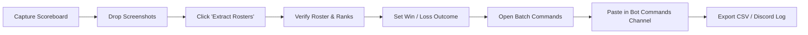

# Winslow Accord Event Extractor — Officer & Host Operator Guide

[](https://www.roblox.com/groups/825966682)
[](https://roblox-event-extractor.onrender.com)
[](https://ai.google.dev/)
[](https://discord.com)

Welcome to the **Roblox Event Extractor & Attendance Engine** operator manual. This guide is tailored for **Winslow Accord Clan Officers, Field Commanders, Marshals, and Event Hosts**.

This platform automates post-event attendance, score verification, and Winslow Accord bot XP grant distribution directly from in-game scoreboard screenshots using Google Gemini 2.5 Flash multimodal AI.

---

## 📋 Quick Reference Workflow



---

## 🚀 Step 1: Accessing the Dashboard

### Production URL
Open your web browser and navigate to the live deployment:
🔗 **`https://roblox-event-extractor.onrender.com`**

> [!NOTE]
> **Render Cold-Start Notice (~30–50 Seconds)**:
> The web application runs on Render's managed cloud. If no clan operations have occurred within the last 15 minutes, the web container spins down into sleep mode to conserve resources.
> - **Initial load**: If the dashboard takes 30–50 seconds to respond, **do not panic or repeatedly refresh**. The server is spinning up its Python container and loading the Roblox Group Roster cache.
> - **Connectivity Confirmation**: Once loaded, verify the top navigation bar displays the green status pill:
>   `● Cloud Sync: Connected` and `Winslow Accord (825966682)`.

---

## 📸 Step 2: Capturing & Uploading Match Screenshots

### Best In-Game Screenshot Practices
For the fastest extraction and highest OCR accuracy, instruct your officers or designated screenshotters to follow these standards during operations:
1. **Open Full Scoreboard Tab**: Hold `Tab` (or toggle your game’s designated leaderboard menu) right when the match concludes.
2. **Capture Both Teams Completely**: Ensure the scoreboard displays both **Snow Core / Defending Force** and **Raiders / Attacking Force** with player names, kills, damage, heals, and captures visible.
3. **Screen Framing**: Fullscreen or native windowed captures (1080p, 1440p, or 4K) are ideal. Cropped images are acceptable as long as the entire table header and usernames remain legible.
4. **Respawn & Banner Overlays**: The vision engine handles semi-transparent red **"YOU DIED"** screens and combat motion blur, but unobstructed viewfinders yield the fastest verification.

### Staging & Extracting Files
1. **Drag and Drop**: Drag one or multiple match screenshot files (`.png`, `.jpg`, `.jpeg`) into the large dropzone labeled:
   > *"Drop match screenshots here or browse"*
2. **Batch Multi-Match Upload**: You can upload an entire multi-round operation at once (e.g., 3 to 6 rounds of Defense/Raid).
3. **Review Staged Thumbnails**: Each screenshot appears in the staging strip with its filename and file size.
   - If an accidental file was staged, click the small `×` (Remove) button on that thumbnail.
   - Click `Clear` to wipe the staging tray if needed.
4. **Initiate Extraction**: Click the blue **"Extract Rosters"** button. The AI pipeline will:
   - Run multimodal OCR via Gemini 2.5 Flash.
   - Match player names against the official **Winslow Accord** group roster.
   - Disambiguate visually deceptive sans-serif characters (e.g. `l` vs `I`, `0` vs `O`).
   - Query the cloud persistent store for known Discord IDs.

---

## 🔍 Step 3: Roster Review & Verification

After extraction finishes, the **Matches** section dynamically renders a card for each uploaded match.

```
+-----------------------------------------------------------------------------------+
| Match #1: Outpost Defense (Snow Core vs Raiders)             [ Win ] [ Loss ] [x] |
+-----------------------------------------------------------------------------------+
| Clan Team: [ Snow Core (8) Clan Roster ]  [ Raiders (7) ]                         |
+-----------------------------------------------------------------------------------+
| PLAYER          STATUS       ROLE        DISCORD ID             K    D    H   C   |
| (V) Savio_R     Verified     Marshal     <289456182901234567>   14  2100  3   2   |
| (!) Guest_44    Unverified   Guest       [ Enter Discord ID ]    4   650  0   0   |
+-----------------------------------------------------------------------------------+
| + Add Player: [ Roblox Username ] [ Kills ] [ Damage ] [ Add to Roster ]          |
+-----------------------------------------------------------------------------------+
```

### Understanding Status Indicators & Rank Badges
- 🟢 **Green Dot ("Verified")**: The player was successfully matched to an active member of the Winslow Accord Roblox Group (`825966682`). Their official rank badge is automatically assigned:
  - **Officers / Marshals**: Marked with a gold/emerald badge (e.g., `Marshal`, `Commander`).
  - **Non-Commissioned Officers**: Marked with a cyan badge (e.g., `Captain`, `Lieutenant`).
  - **Enlisted Members**: Marked with a slate/blue badge (e.g., `Specialist`, `Sergeant`, `Private`).
- 🟡 **Yellow Dot ("Unverified")**: The user was not detected in the Winslow Accord Roblox group. They are tagged as `Guest`. Guests are tracked in match statistics but will not receive clan XP unless manually updated.
- 🏷️ **Disambiguation Badge (`OCR: ...`)**: If the AI corrected an ambiguous OCR reading (such as OCR seeing `SAVlO_R` with a lowercase `l` and auto-correcting to canonical roster member `SAVIO_R`), an informational pill displays the raw detection.

### Team Tab Selection
In multi-team games, click the tab corresponding to the Winslow Accord roster (e.g., `Snow Core (8)` marked with the `Clan Roster` badge). The UI remembers this selection and tallies XP exclusively for your designated clan team.

### Adding Missing or Disconnected Players
If a clan member disconnected seconds before round end or their name was completely obscured:
1. Scroll to the bottom of the match roster table to the **+ Add Player** row.
2. Enter the player's exact Roblox username into the text box.
3. (Optional) Enter their estimated kills and damage.
4. Click **"Add to Roster"** (or press `Enter`).
5. The system performs an on-the-fly verification check against Roblox APIs:
   - Validates their clan membership and current rank.
   - Pulls their saved Discord snowflake from the cloud store.
   - Automatically recalculates event attendance and XP.

---

## 🆔 Step 4: Managing Discord IDs (One-Time Setup)

Winslow Accord bot slash commands support both Discord user snowflake mentions (`<@USER_ID>`) and Roblox usernames. Linking Discord IDs ensures members are cleanly credited with direct Discord mentions in bot dispatches. The dashboard features an **intelligent persistent cloud store** (`discord_store.py`).

### How to Link a Player's Discord ID
1. When a player does not have a linked Discord ID, their input box is highlighted with an amber border:
   `e.g. 289456182901234567`
2. Obtain the member's Discord snowflake:
   - **Discord Developer Mode**: In Discord, right-click any user's profile $\to$ click **Copy User ID**.
   - Alternatively, you can paste full `<@123456789012345678>` strings—the system automatically sanitizes extra characters.
3. Click into the **Discord ID** cell for that player and paste the snowflake.

### Permanent Cloud Synchronization
> [!IMPORTANT]
> **One-Time Cloud Sync**:
> As soon as you enter a Discord ID, it is asynchronously dispatched to the cloud server (`POST /api/discord_ids`) and committed to the thread-safe database (`discord_mappings.json`).
> - **Shared Intelligence**: Once an officer links a player's Discord ID, **no officer will ever need to enter it again** for that player in any future operation.
> - **Persistent Across Devices**: Stored IDs sync across all host machines and browser sessions automatically.

---

## ⚖️ Step 5: Win/Loss Selection & Recalculation

At the top right of each match card, toggle the outcome button:
- `[ Win ]` (Emerald highlight)
- `[ Loss ]` (Red highlight)

### Automatic vs. Manual Override
- **Automatic Detection**: The Gemini vision model inspects the scoreboard scores and victory banners to pre-select `[ Win ]` or `[ Loss ]`.
- **Manual Toggle**: If the round ended in a technical draw, tiebreaker, or specific scrim ruling, click the desired button to toggle.

### Real-Time XP Formula
XP is calculated instantly without requiring a page reload:
- **Standard Win**: **+10 XP** per verified clan member.
- **Standard Loss**: **+5 XP** per verified clan member.
- **Custom Multipliers**: If host rules award bonus XP (e.g. +15 Win / +8 Loss), update the **Win / Loss** inputs in the top navbar or via Clan Settings. All match tallies update immediately.

### Attendance Deduplication
If an operation consists of 3 rounds:
- Round 1: Win (+10 XP)
- Round 2: Loss (+5 XP)
- Round 3: Win (+10 XP)

A member participating in all three rounds receives **25 XP**. A member who only attended Round 1 receives **10 XP**. The engine automatically deduplicates user presence across all rounds.

---

## ⚡ Step 6: Generating & Copying Bot Commands

Once all matches are reviewed and outcomes are set, navigate to the **Attendance & XP Leaderboard** section at the bottom of the page.

### The Batch Bot Slash Commands Workflow (Recommended)
1. Click the **"Batch Commands"** button in the leaderboard action bar (or copy single-match commands directly from each match card header).
2. The **Batch Bot Slash Commands** modal opens:
   - It intelligently clusters all participants by their exact total earned XP.
   - For example, if 8 members earned 25 XP and 2 members earned 10 XP, the generator produces clean, batched Winslow Bot slash commands:

```text
/xp-add target:<@314159265358979323> <@271828182845904523> behbeh1163 amount:25
/xp-add target:<@141421356237309504> Guest_Player amount:10
```

3. **Target Resolution Rule & Unmapped Players**:
   - **Discord Mentions**: Players with a mapped Discord snowflake in the persistent cloud store appear formatted as `<@USER_ID>`.
   - **Clean Username Fallback**: Unmapped players seamlessly fall back to their Roblox username directly in the command (e.g., `behbeh1163`).
   - **No Blocking Placeholders**: Commands are immediately copy-pasteable without missing ID placeholders or manual redactions. XP is granted to all participants regardless of Discord link status.
   - *(Optional)* To link an unmapped member before running the command, enter their Discord snowflake into their table row.
4. **Copying Commands**:
   - Click **"Copy Command"** on any specific tier card, or click **"Copy All Commands"** at the bottom of the modal to copy every tier into your clipboard.
5. **Paste into Discord**:
   - Switch to your clan Discord server.
   - Navigate to the designated bot channel (e.g., `#bot-commands` or `#officer-commands`).
   - Paste and press `Enter` to grant XP.

---

## 💾 Step 7: Archiving Attendance (CSV & Discord Exports)

To maintain an immutable record for clan logs and officer promotions, utilize the one-click export tools in the Leaderboard toolbar:

| Action Button | Output Format | Intended Destination |
| :--- | :--- | :--- |
| **"Copy Discord List"** | Formatted Discord Markdown with bullet points, ranks, and XP | `#event-logs` or `#announcements` channel |
| **"Copy Markdown"** | GitHub / Notion Markdown table with full stats | Officer notion board, forum debriefs, or GitHub repos |
| **"Export CSV"** | `.csv` spreadsheet file (`winslow_accord_event_YYYY-MM-DD.csv`) | Clan Google Drive, Google Sheets, or Excel attendance trackers |

### Example Discord Roster Output
```markdown
**Winslow Accord — Event Attendance Log**
**Date**: 2026-11-17 | **Total Matches**: 3 | **Clan Outcome**: 2W - 1L

**Attendees (8 Verified)**:
• **Savio_R** (Marshal) — 3 Events (2W, 1L) | 38 Kills | **25 XP** (<@289456182901234567>)
• **Kaelen_WA** (Specialist) — 3 Events (2W, 1L) | 24 Kills | **25 XP** (<@192837465019283746>)
• **VanguardV** (Private) — 1 Event (1W, 0L) | 8 Kills | **10 XP** (<@987654321098765432>)
```

---

## ⚙️ Officer Settings & Configuration

Click the clan status badge in the top navigation bar (`Winslow Accord (825966682)`) to open the **Clan Settings** modal.

### Configurable Options
1. **Clan Name**: Change the displayed organization title.
2. **Roblox Group ID**: Default is `825966682`. If hosting a joint operation with a sub-division, detachment, or allied clan, change this ID to dynamically verify attendees against the alternate group.
3. **Win XP / Loss XP**: Default is `10` and `5`. Change these values if running double-XP weekend operations or training scrims.
4. **Discord ID Storage Count**: View how many Roblox-to-Discord mappings are cached in the cloud database.
5. **Reset & Clean**: Use the `Reset` button in the navigation header to clear all staged files and active events before starting the next event debrief.

---

## ❓ Troubleshooting & FAQs

### Q1: The web dashboard takes almost a minute to open or shows a loading spinner.
> **Answer**: The application is waking up from Render's free tier sleep cycle (~30–50s). Simply wait for the initial load. Once awake, all vision extraction, roster caching, and command generation operate with sub-second latency.

### Q2: A clan member appears with a Yellow Dot ("Unverified Guest") despite being in the clan.
> **Possible Causes & Remedies**:
> 1. **Recently Joined Member**: The server caches group members for efficiency. If a player joined the Roblox group 5 minutes before the scrim, the cache may not have their ID yet. Click the `+ Add Player` bar, re-type their exact username, and submit to force a live fetch.
> 2. **Severely Distorted Name**: If the screenshot font was heavily distorted and the disambiguation engine couldn't map it, delete the row and add them manually via `+ Add Player`.
> 3. **Display Name vs. Username**: Roblox scoreboards sometimes show Display Names instead of usernames. Enter the player's true `@Username` in `+ Add Player`.

### Q3: A player crashed or disconnected before the final scoreboard appeared.
> **Answer**: Do not worry! Leave the extracted scoreboard intact and simply use the **+ Add Player** tool at the bottom of the match card to insert them into the roster. They will receive identical attendance and Win/Loss XP.

### Q4: What happens if a player doesn't have a linked Discord ID?
> **Answer**: Unmapped players seamlessly fall back to their Roblox username in the `/xp-add` command (e.g., `target:<@289456182901234567> RobloxPlayer2 amount:10`). The Winslow Bot recognizes Roblox usernames directly, ensuring all attendees receive their XP without blocking or requiring manual placeholder fixes. You can still paste their Discord snowflake into the **Discord ID** field at any time to link their account permanently for future operations.

### Q5: Can multiple officers use the dashboard at the same time?
> **Answer**: Yes. The backend persistent store uses thread-safe atomic file writes with file locking (`discord_store.py`). When Officer A enters a Discord ID for a player, it is committed to the cloud database and will be available for Officer B upon page refresh.

### Q6: Can I run this locally if Render is ever down?
> **Answer**: Yes. Clone the GitHub repository, install requirements (`pip install -r requirements.txt`), ensure your `.env` contains a valid `GEMINI_API_KEY`, and run `uvicorn app:app --port 8000`. Navigate to `http://localhost:8000`.

---

*Winslow Accord Clan Operations &bull; Automated Attendance & Winslow Bot XP Engine*
