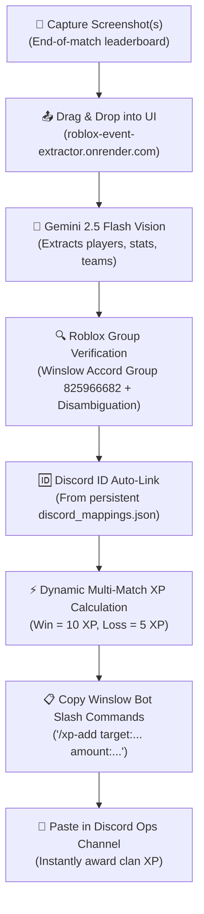

# Roblox Event Extractor & Attendance Engine (Winslow Accord Ops)

[](https://roblox-event-extractor.onrender.com)
[](https://github.com/himkhadr-boop/roblox-event-extractor)
[](https://www.python.org/)
[](https://fastapi.tiangolo.com/)
[](https://ai.google.dev/)
[](https://groups.roblox.com/)

A high-performance, automated attendance and XP tracking engine built for **Winslow Accord** Roblox operations. The engine ingests post-match leaderboard screenshots (even low-contrast, blurred, or occluded captures), extracts in-game player statistics via Google Gemini 2.5 Flash multimodal vision, cross-verifies usernames against official Roblox group rosters with disambiguation heuristics, computes multi-match XP tallies, and produces ready-to-paste **Winslow Bot** (`/xp-add`) Discord slash commands.

---

## 🌟 Key Capabilities

### 1. Multimodal OCR & Stat Extraction (Gemini 2.5 Flash)
- **Extreme Condition Resilience**: Accurately transcribes player names, scores, kills, deaths, damage, heals, and captures even when obscured by semi-transparent red **"YOU DIED"** respawn banners, motion blur, compression artifacts, or custom in-game leaderboard typography.
- **Team & Match Outcome Detection**: Identifies team splits, objective scores, and automatically resolves match winners and losers based on final scoreboards.
- **Multi-Image Batch Ingestion**: Upload multiple match screenshots simultaneously to aggregate full multi-round scrims or operations into a single report.

### 2. Group Roster Verification & Disambiguation Engine
- **Target Clan Scope**: Winslow Accord (`Group ID: 825966682`).
- **Cursor-Paginated Pre-Fetching**: Fetches and caches canonical group rosters from the official Roblox Groups API (`https://groups.roblox.com/v1/groups/{group_id}/users`).
- **Sans-Serif Disambiguation Heuristics**: Solves notorious sans-serif OCR misinterpretations through automatic permutation matching:
  - Uppercase `I` vs. Lowercase `l` vs. Lowercase `i` (e.g. `SAVIO_R` $\leftrightarrow$ `SAVlO_R`)
  - Numeric `0` vs. Uppercase `O` vs. Lowercase `o`
  - Tight kerning / ligature collapse: `cl` $\leftrightarrow$ `d`, `di` $\leftrightarrow$ `cl` (e.g. `flanked` $\leftrightarrow$ `flankecl`)
  - Letter blending: `rn` $\leftrightarrow$ `m` (e.g. `burn` $\leftrightarrow$ `bum`)
- **Affiliation Tagging**: Flags non-clan members, mercenary guests, and clan officers with official rank badges directly in the UI.

### 3. Dynamic Multi-Match XP Calculation
- **Configurable XP Matrices**: Default Clan standard: **Win = 10 XP**, **Loss = 5 XP** (configurable on the fly via UI or environment variables).
- **Attendance Deduplication**: Players participating across multiple rounds receive cumulative attendance XP while ensuring single-award integrity per discrete event.
- **Comprehensive Match Analytics**: Aggregates total kills, damage, heals, and flag/terminal captures across all matches with automatic rank ordering.

### 4. Winslow Bot Slash Command Generator
- **Instant Discord Command Formatting**: Formats verified rosters directly into Winslow Accord custom bot slash command syntax:
  ```text
  /xp-add target:<@123456789012345678> behbeh1163 amount:10
  /xp-add target:<@987654321098765432> amount:5
  ```
- **Target Resolution**: Uses Discord snowflake mentions (`<@ID>`) for mapped players, or seamlessly falls back to their Roblox username for unmapped players (multi-target space-separated).
- **Batching & Discord Limit Chunking**: Automatically groups targets by XP award tiers and chunks command batches to strictly stay within Discord's 2,000-character message limit.

### 5. Persistent Roblox-to-Discord Mapping Store
- **Centralized Mapping Cache**: Stores verified mappings between Roblox usernames and Discord snowflake IDs (`discord_mappings.json`).
- **Thread-Safe File Persistence**: Supports hot additions and bulk synchronization through the web UI and REST API.
- **Shared Clan Intelligence**: Once an officer maps a player's Discord ID, it is permanently preserved across subsequent extractions.

### 6. Hand-Crafted Linear/Vercel Matte Dark Interface
- **Modern Aesthetic**: Deep matte obsidian theme with subtle micro-borders, clean typography, and responsive controls.
- **Live Interactive Review**: Edit transcribed stats, toggle Win/Loss status per match, remap unmatched usernames, and preview Discord text or Winslow Bot slash commands in real time.
- **One-Click Exports**: Copy Winslow Bot slash commands, plain Discord text leaderboards, or download comma-separated CSV spreadsheets for clan records.

---

## 🏗️ Architecture & Key Files

```
roblox-event-extractor/
├── app.py                   # FastAPI application, REST endpoints, static mounting
├── config.py                # Environment variable loader, API key pool, clan defaults
├── gemini_vision.py         # Gemini 2.5 Flash multimodal vision engine & extraction prompts
├── roblox_verifier.py       # Roblox API client, roster caching & OCR disambiguation
├── xp_engine.py             # Attendance tracking, multi-event XP tally, Winslow Bot generator
├── discord_store.py         # Thread-safe persistent JSON store for Roblox <-> Discord IDs
├── discord_mappings.json    # Local/cloud persistent Discord mapping database
├── render.yaml              # Render.com Blueprint configuration for 1-click cloud deploy
├── requirements.txt         # Production Python dependencies
├── Procfile                 # Process launcher for PaaS environments
└── static/
    └── index.html           # Single-page Linear/Vercel matte dark UI
```

### Component Breakdown

| File | Role | Description |
| :--- | :--- | :--- |
| [`app.py`](file:///C:/Users/mokak/.gemini/antigravity/scratch/roblox-event-extractor/app.py) | **Application Controller** | Exposes REST endpoints (`/api/extract`, `/api/calculate_xp`, `/api/verify_user`, `/api/discord_ids`, `/api/config`, `/api/health`) and serves the static frontend. |
| [`config.py`](file:///C:/Users/mokak/.gemini/antigravity/scratch/roblox-event-extractor/config.py) | **Configuration Manager** | Loads `.env` settings, manages API key arrays for load distribution, and sets default group parameters (`DEFAULT_CLAN_GROUP_ID=825966682`). |
| [`gemini_vision.py`](file:///C:/Users/mokak/.gemini/antigravity/scratch/roblox-event-extractor/gemini_vision.py) | **Vision Engine** | Sends base64-encoded screenshot buffers to Google Gemini 2.5 Flash with strict JSON schema definitions for accurate roster and stat extraction. |
| [`roblox_verifier.py`](file:///C:/Users/mokak/.gemini/antigravity/scratch/roblox-event-extractor/roblox_verifier.py) | **Roster Verification** | Communicates with `groups.roblox.com` and `users.roblox.com`, utilizing fuzzy and algorithmic substitutions (`SAVlO_R`, `flankecl`) to reconcile OCR typos against clan rosters. |
| [`xp_engine.py`](file:///C:/Users/mokak/.gemini/antigravity/scratch/roblox-event-extractor/xp_engine.py) | **XP & Command Engine** | Accumulates match stats, deduplicates player presence across events, calculates XP rewards, and formats Winslow Bot (`/xp-add`) slash commands and CSV output. |
| [`discord_store.py`](file:///C:/Users/mokak/.gemini/antigravity/scratch/roblox-event-extractor/discord_store.py) | **Persistence Store** | Thread-safe manager for `discord_mappings.json`, storing normalized Roblox-to-Discord ID pairs for automated bot mention creation. |
| [`static/index.html`](file:///C:/Users/mokak/.gemini/antigravity/scratch/roblox-event-extractor/static/index.html) | **Web Interface** | Zero-dependency, sleek single-page frontend with drag-and-drop file ingestion, editable match tables, command preview, and instant clipboard utilities. |
| [`render.yaml`](file:///C:/Users/mokak/.gemini/antigravity/scratch/roblox-event-extractor/render.yaml) | **Cloud Blueprint** | Declarative deployment specification defining build steps, start commands, and environment variable bindings on Render. |

---

## ⚡ Local Development Quickstart

### Prerequisites
- **Python 3.11+** installed on your system.
- A **Google Gemini API Key** (obtain free from [Google AI Studio](https://aistudio.google.com/)).

### Step-by-Step Installation

1. **Clone the repository**:
   ```bash
   git clone https://github.com/himkhadr-boop/roblox-event-extractor.git
   cd roblox-event-extractor
   ```

2. **Create and activate a virtual environment**:
   - **Windows (PowerShell)**:
     ```powershell
     python -m venv venv
     .\venv\Scripts\Activate.ps1
     ```
   - **Linux / macOS**:
     ```bash
     python3 -m venv venv
     source venv/bin/activate
     ```

3. **Install dependencies**:
   ```bash
   pip install -r requirements.txt
   ```

4. **Configure environment variables**:
   Create a `.env` file in the project root:
   ```env
   GEMINI_API_KEYS=your_gemini_api_key_here
   DEFAULT_CLAN_NAME=Winslow Accord
   DEFAULT_CLAN_GROUP_ID=825966682
   WIN_XP=10
   LOSS_XP=5
   PORT=8000
   HOST=127.0.0.1
   ```
   > [!TIP]
   > Multiple comma-separated Gemini API keys can be supplied in `GEMINI_API_KEYS` (e.g. `key1,key2,key3`) for automatic rotation and quota distribution.

5. **Run the local development server**:
   ```bash
   uvicorn app:app --reload --host 127.0.0.1 --port 8000
   ```
   *(Or run directly via `python app.py`)*

6. **Open the interface**:
   Navigate your browser to `http://localhost:8000`.

---

## 🚀 Production Deployment

### Option A: Free Cloud Deployment on Render (Recommended)

The repository includes a ready-to-use [`render.yaml`](file:///C:/Users/mokak/.gemini/antigravity/scratch/roblox-event-extractor/render.yaml) blueprint.

1. **Push your code to GitHub**:
   ```bash
   git add .
   git commit -m "Deploy to production"
   git push origin main
   ```

2. **Deploy via Render Blueprint**:
   - Sign in to the [Render Dashboard](https://dashboard.render.com/).
   - Click **New +** $\rightarrow$ **Blueprint**.
   - Select your repository (`himkhadr-boop/roblox-event-extractor`).
   - In the Environment Variables configuration, set:
     - `GEMINI_API_KEYS`: Your Gemini API key(s).
   - Click **Apply**. Render will automatically build and deploy the container.

3. **Live URL**:
   Your production service will be accessible with automatic HTTPS at:
   `https://roblox-event-extractor.onrender.com`

### Option B: Local Host with Free ngrok Tunnel

If you prefer hosting the extractor on a local machine with a public URL:

1. Install ngrok (`winget install ngrok` or from [ngrok.com](https://ngrok.com/)).
2. Authenticate your ngrok token:
   ```powershell
   ngrok config add-authtoken <YOUR_TOKEN>
   ```
3. Start the local server:
   ```powershell
   python app.py
   ```
4. Expose the port through an ngrok static domain:
   ```powershell
   ngrok http --domain=<your-static-domain>.ngrok-free.app 8000
   ```

---

## ⚙️ Environment Configuration Reference

| Variable | Type | Default | Description |
| :--- | :--- | :--- | :--- |
| `GEMINI_API_KEYS` | String (Comma-separated) | `""` | Google Gemini API key(s) used for multimodal OCR image processing. |
| `DEFAULT_CLAN_NAME` | String | `Winslow Accord` | Default clan organization name displayed across UI and exports. |
| `DEFAULT_CLAN_GROUP_ID` | Integer | `825966682` | Default Roblox Group ID against which player rosters are validated. |
| `WIN_XP` | Integer | `10` | Default XP points awarded to players on the winning team. |
| `LOSS_XP` | Integer | `5` | Default XP points awarded to players on the losing team. |
| `PORT` | Integer | `8000` | Port for the Uvicorn web server. (Overridden dynamically by `$PORT` on Render). |
| `HOST` | String | `127.0.0.1` | Host address binding for the Uvicorn web server. |

---

## 📋 REST API Reference

### Screenshot Transcription
- **`POST /api/extract`**
  - **Payload**: `multipart/form-data` with `files` (array of image files) and optional `clan_group_id` (int).
  - **Response**: Array of parsed event objects enriched with verified Roblox user details and Discord IDs.

### XP Calculation
- **`POST /api/calculate_xp`**
  - **Payload**:
    ```json
    {
      "events": [...],
      "win_xp": 10,
      "loss_xp": 5
    }
    ```
  - **Response**:
    ```json
    {
      "leaderboard": [...],
      "discord_text": "...",
      "csv_text": "...",
      "bot_commands": "/xp-add target:<@123456789012345678> behbeh1163 amount:10\n...",
      "clan_labs_commands": "/xp-add target:<@123456789012345678> behbeh1163 amount:10\n...",
      "summary": { "total_events": 1, "unique_players": 12, "total_xp_awarded": 110 }
    }
    ```

### User Verification
- **`POST /api/verify_user`**
  - **Payload**: `{"username": "flankecl", "clan_group_id": 825966682}`
  - **Response**: `{"raw": "flankecl", "verified_name": "flanked", "user_id": 1234567, "in_clan": true, "clan_role": "Officer", "is_verified": true}`

### Discord ID Store
- **`GET /api/discord_ids`**: Fetches all cached Roblox-to-Discord mappings.
- **`POST /api/discord_ids`**: Updates a single user (`{"username": "...", "discord_id": "..."}`) or batch updates (`{"mappings": {"user1": "id1", "user2": "id2"}}`).

---

## 🛡️ Clan Operations Workflow (Officer Guide)



1. **Capture**: Take screenshot(s) of the final match scoreboard in Roblox.
2. **Upload**: Drop the image(s) onto the web interface.
3. **Verify**: Inspect extracted players. Any unlinked Discord IDs can be populated with a single click.
4. **Export**: Click **Copy Winslow Bot Command** to copy the formatted `/xp-add` slash command.
5. **Award**: Paste directly into your clan Discord operations channel.

---

## 📜 License & Acknowledgments

- **Organization**: Winslow Accord Clan Operations.
- **Powered By**: Google Gemini 2.5 Flash, FastAPI, and the Roblox Public Web API.
